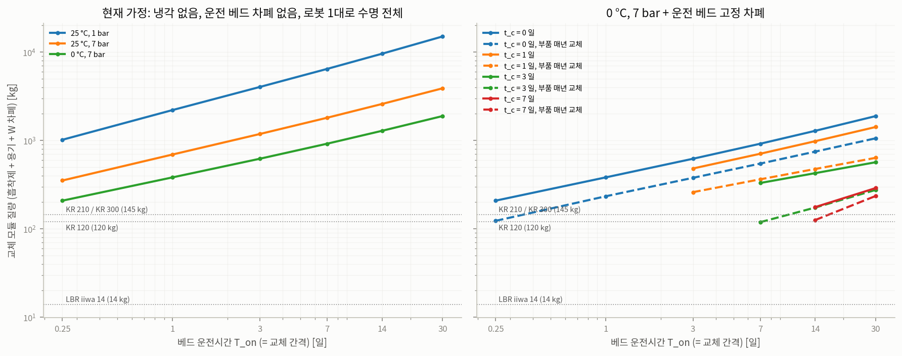

# Xe 이중베드 교체 조건 분석 (2026-10-11)

E 파트 (경로계획 알고리즘 설계 및 시뮬레이션 구현) / 담당: 백재은

수치 원본: `outputs/xe_bed/budget_table.csv`, `outputs/xe_bed/unit_dose.csv`, `outputs/xe_bed/summary_xe_bed.json`, `outputs/heavy_robot/summary_heavy_robot.json`
입력값/근거: `config/xe_bed.json`

10/06 회의 결정(Xe 단일 타겟, 이중베드 유지, 17 kg 이상 하중 로봇)을 계산에 넣은 첫 결과.

## 1. 요약

1) 상온/대기압 활성탄으로 Xe를 잡으면 흡착제가 하루 약 91 kg씩 필요함
   - He 50 L/min을 그대로 받는 포집 베드는 흡착제 질량에 비례해서만 오래 버팀
   - 9 kg 카트리지는 약 2.4시간이면 파과
   - 0 °C/7 bar 운전이면 하루 약 4.4 kg으로 감소
2) 막 분리한 베드 옆에서는 차폐 없이 작업 X
   - 7일 운전한 Xe 베드: 1 m에서 Si 기준 약 6,900 Gy/h (상한 추정)
   - 차폐 없이 1회 교체 시 손목 카메라(C09) 약 3,200 Gy -> 카메라 한계(60 Gy, RDM 2 적용)의 50배 이상
3) 교체 횟수가 부품 예산을 결정
   - 7일마다 교체하면 수명 27 EFPY 동안 약 1,400번
   - 카메라가 1,400번을 버티려면 1회 약 43 mGy까지만 허용
4) 로봇이 모듈을 직접 드는 방식은 성립 범위가 좁다고 판단됨
   - 0 °C/7 bar + 운전 베드 고정 차폐 + 분리 후 3~7일 냉각 + 로봇 부품 매년 교체를 모두 만족해야 모듈 약 120~130 kg -> KR 120~300급 가능
   - 하나라도 빠지면 모듈 수백 kg~수 t
5) iiwa 14는 모든 조건에서 불가
   - 정격 가반하중 14 kg (이전 문서의 17.1 kg은 토크만 본 계산값이라 정격 초과)
   - KR 120/210/300 R2700-2도 경사 조건 먼 자세에서 약 137~148 kg이 한계 (A2 어깨 관절)
6) "드물게 교체"하는 운영(재생 또는 지연베드, 흡착제 수명 끝에만 교체)은 선량 문제가 거의 없음
   - 대신 모듈 수백 kg~수 t -> 크레인이 들고 로봇은 커플링 작업만 하는 구조
   - MARINA 공개 유지보수 개념(선내 크레인)과 같은 방향

## 2. 계산 배경

10/06 회의 결정 사항
- 타겟 = Xe 하나(주로 Xe-135), Kr 베드는 다루지 않음
- 이중베드 유지: 한 베드가 포화되면 다른 베드로 전환 + 포화된 베드 교체
- 17 kg 이상 하중 로봇 필요

세 항목의 연결
- 베드 질량 = He 유량 × 베드 운전시간 / 흡착계수 (정현 님 파과시간과 같은 식)
- 교체 횟수 = 수명 / 베드 운전시간 -> 부품 1회 허용 선량 = TID_lim / 교체 횟수 (서현 님 TID_lim)
- 1회 허용 선량 -> 필요 차폐 두께 -> 차폐 질량 + 베드 질량 = 로봇이 들어야 할 무게 (유정 님 로봇 하중)

-> 로봇 하중 요구를 정하려면 위 세 식을 같이 풀어야 해서 계산 스크립트(`11`, `12`)를 따로 작성.

## 3. 계산 흐름

```
베드 운전시간 T_on ─┬─ 흡착제 질량 m = Q·T_on / (0.8·K)              (Underhill 2003 식 2, KAERI 슬라이드 11)
                    ├─ 교체 횟수 N_ex = 27 EFPY / T_on
                    │        └─ 부품 예산 B_k = (고장선량_k / RDM) / N_ex      (서현 10/6)
                    └─ 분리 시점 Xe 재고 (MARINA spec 식) ─ 냉각 t_c 후 재고
                              └─ 선원 세기 [Gy/h @ 1 m, Si]
B0 궤적의 부품별 단위 선량 d_k ───────────────┐
                                             ▼
                교체 1회 선량 D_k(x) = Σ (선원 세기 × e^(-μx)) × d_k
                                             ▼
                max_k D_k(x)/B_k ≤ 1 이 되는 최소 차폐 두께 x
                                             ▼
                모듈 질량 = 흡착제 + 용기 + 차폐  ─ 로봇 사용 가능 하중과 비교
```

단위 선량 d_k
- 현재 B0 궤적(iiwa, 2 m 셀, 총 190 s)에서 Bed A 또는 Bed B 세기를 1 Gy/h @ 1 m로 두고 구한 부품 누적선량
- 선량이 선원 세기에 비례하므로 한 번 구해 두고 모든 시나리오에 곱해서 사용

교체 중 Bed B
- 교체 중 Bed B는 운전 중
- 전환 직후라 재고는 적지만, Bed A를 냉각하는 t_c 동안 Bed B에 Xe-135가 쌓임
  -> 냉각을 길게 할수록 A는 식고 B는 뜨거워지는 관계

제약
- 냉각 + 교체가 Bed B 파과 전에 끝나야 하므로 t_c < T_on인 경우만 계산

## 4. 입력/근거

| 항목 | 값 | 근거 |
|---|---|---|
| 열출력 | 100 MWth | MARINA 공개값 |
| 방출분율 ε | 1 | 가정, 상한 (MARINA spec) |
| 베드 전단 지연 t_d | 2 h | 가정, MSRE 설계값 (MARINA spec) |
| 핵종 | Xe-133m, Xe-133, Xe-135 | spec 수율(U-235 열중성자 값과 일치, refs/notes/08). 감마선은 서현 10/6 NNDC 표와 일치 |
| Xe Henry 상수 K | 1,090 cm³/g (25 °C) | KAERI Hong 2023 IAEA 발표 slide 10, 44 mmol/kg를 환산 (refs/notes/10) |
| 온도 의존 | exp(5880/T[°R]) | Ackley & Browning, ORNL-4541 p.103 |
| 동적 용량 비 | 0.8 | KAERI Hong 2023 slide 11 |
| 충전밀도 | 0.6 g/cm³ | KAERI Hong 2023 slide 9 |
| He 유량 | 50 L/min (STP) | 가정, MARINA spec |
| 모듈 형상 | H/D = 3, 스테인리스 용기 5 mm | 가정 |
| 감쇠계수 | Si μen/ρ, Pb·W μ/ρ | NIST XCOM 표 (2026-10-11 조회) |
| 고장선량 | 관절 164.55 Gy, 공구 보드 219 Gy, 카메라 120 Gy | Zhang 2020 Table 2(iiwa 7 엔코더), Coloma 2023(MCU 하한), 서현 10/6 표 |
| RDM | 2 | 서현 10/6 |
| 수명 | 27 EFPY | MARINA spec No.19 (공개 출처 미확인) |

## 5. 결과

### (1) 흡착제 소요량

| 운전 조건 | K [cm³/g] | 흡착제 소요량 [kg/일] | 9 kg 카트리지 수명 |
|---|---|---|---|
| 25 °C, 1 bar | 1,090 | 91.3 | 약 2.4 h |
| 25 °C, 7 bar | 1,090 | 13.1 | 약 17 h |
| 0 °C, 7 bar | 2,971 | 4.4 | 약 2.1 일 |

- Xe 농도가 수십 ppm이면 흡착량이 농도에 비례 (q0 = K·C0)
  - 파과 중심 시점 t = K·m/Q (Underhill 2003 식 2) -> 입구 농도 C0와 무관
  - 파과 시점은 흡착제 질량, 온도, 압력, He 유량으로 결정
- 정현 님 Thomas 모델 민감도 분석에서 q0와 C0는 독립 변수로 두면 X

### (2) 차폐 없이 교체할 경우

- 7일 운전한 Bed A 선원 세기: 1 m에서 Si 기준 6,875 Gy/h (`summary_xe_bed.json`)
- C09 손목 카메라 단위 선량 0.459 Gy/(Gy/h @ 1 m) -> 차폐 없는 교체 1회에 약 3,160 Gy
- 이 중 약 79%가 체류(S2 해제, S5 체결) 구간에서 발생. 가상 선원 기준 기존 결과(체류 75%)와 같은 경향
- 한계 대비 비율이 가장 나쁜 부품은 C09 (단위 선량 최대, 한계 최저 60 Gy)

### (3) 필요 차폐 / 모듈 질량

- W(텅스텐) 차폐를 모듈에 붙인다고 보고, 부품 예산을 만족하는 최소 두께와 그때 모듈 질량을 계산
- "운전 베드 고정 차폐" = Bed B를 셀에 고정된 차폐벽이 가린다고 본 경우

| 운전 조건 | T_on | t_c | 운전 베드 고정 차폐 | 흡착제 [kg] | 교체 횟수 | W 두께 [mm] | 모듈 [kg] | 부품 매년 교체 시 모듈 [kg] |
|---|---|---|---|---|---|---|---|---|
| 25 °C, 1 bar | 7 일 | 0 | 무관 | 639 | 1,409 | 40.5 | 6,443 | 4,177 |
| 0 °C, 7 bar | 7 일 | 0 | 무관 | 30.7 | 1,409 | 40.5 | 918 | 547 |
| 0 °C, 7 bar | 7 일 | 3 일 | 있음 | 30.7 | 1,409 | 14.2 | 330 | **119** |
| 0 °C, 7 bar | 14 일 | 7 일 | 없음 | 61.4 | 704 | 31.1 | 1,072 | 557 |
| 0 °C, 7 bar | 14 일 | 7 일 | 있음 | 61.4 | 704 | 2.2 | 176 | **126** |
| 0 °C, 7 bar | 30 일 | 14 일 | 있음 | 131.5 | 329 | 0.5 | 244 | 232 |

- 굵은 값만 KR 계열이 들 수 있음 (`robots_ok_yearly_parts`). 전체 246개 행은 `budget_table.csv`



표/그림 해석
- 냉각 X(t_c = 0): 분리 직후 Xe-135(9.14 h), Xe-133m이 남아 있어서 두께가 40 mm 밑으로 안 내려감
- 냉각해도 운전 중인 Bed B를 안 가리면 효과가 작음. 냉각하는 사이 Bed B에 Xe-135가 포화되기 때문 (14일 운전 / 7일 냉각에서 고정 차폐 유무에 따라 2.2 mm 대 31.1 mm)
- 3일 이상 냉각하면 남는 선원은 대부분 Xe-133(81 keV). 텅스텐은 81 keV에서 감쇠가 매우 커서 수 mm로 충분
- T_on을 늘리면 교체 횟수가 줄어 차폐는 얇아지지만 흡착제가 늘어 모듈은 무거워짐. 0 °C/7 bar에서는 1~2주가 가장 가벼움

### (4) 로봇 허용 하중

- `12_heavy_robot_check.py`로 KUKA 공식 ROS 2 모델(kroshu/kuka_robot_descriptions, 커밋 d2fa437)을 불러 08과 같은 방식으로 계산
- 조건: 플랜지 수평거리 1.2~2.4 m, 높이 0.2~1.2 m의 12개 자세, 질량중심 오프셋 0.3 m/0.6 m, 경사 7조건, 토크 상한 0.8 × effort

| 로봇 | 정격 [kg] | 경사 포락선 최악 [kg] | 중앙값 [kg] | 실제 쓸 수 있는 값 [kg] | 제한 관절 |
|---|---|---|---|---|---|
| LBR iiwa 14 R820 | 14 | 17.1 (08 결과) | | 14 | A6 |
| KR 120 R2700-2 | 120 | 137.2 | 274.6 | 120 | A2 |
| KR 210 R2700-2 | 210 | 148.3 | 276.2 | 148.3 | A2 |
| KR 300 R2700-2 | 300 | 145.0 | 271.3 | 145.0 | A2 |

- 세 모델 모두 가장 먼 자세(2.4 m)에서 어깨 관절 A2가 한계
  - 로봇 팔 자체 질량(URDF 기준 약 840~870 kg)이 대부분을 차지해서 정격이 큰 모델도 경사에서는 비슷해짐
- 작업 반경을 1.6 m 안쪽으로 두면 중앙값 수준(약 270 kg)까지 올라감 -> 셀 배치에서 베드를 로봇 가까이 두면 하중 문제를 크게 줄일 수 있음
- 확인한 점: 수평 자세에서 정격 하중을 달면 KR 210은 최원거리에서 effort의 0.94 사용, KR 300은 1.12로 effort 초과
  - effort가 최대 토크인지 정격 토크인지 README에 없음 -> 표 절대값은 ±20% 정도 불확실하다고 보는 게 맞을 것 같음

### (5) 드물게 교체하는 운영

- 재생(KAERI PSA/VPSA 방식)이나 지연베드로 운전하고 흡착제 수명이 끝날 때만 교체하는 경우
- 재고는 지연베드 정상상태(T_hold 90 d)로 둠

| 운전 조건 | 교체 간격 | t_c | 흡착제 [kg] | 교체 횟수 | 차폐 없을 때 한계 대비 | W 두께 [mm] | 모듈 [kg] |
|---|---|---|---|---|---|---|---|
| 0 °C, 7 bar | 1 년 | 7 일 | 395 | 27 | 157배 | 0.4 | 616 |
| 0 °C, 7 bar | 1 년 | 30 일 | 395 | 27 | 7.5배 | 0.1 | 595 |
| 25 °C, 1 bar | 1 년 | 30 일 | 8,219 | 27 | 7.5배 | 0.1 | 9,724 |

- 선량은 거의 문제 X. 대신 모듈이 무거워서 로봇이 들 수 없음
- 이 경우 로봇 역할은 들기가 아니라 커플링 해제/체결, 볼트, 검사이고 무게는 크레인이 담당
- 조사한 핫셀 사례(ITER, KAERI PRIDE, ORNL SNS, INL)가 모두 이 분업 구조였고 (refs/notes/12), MSRE 베드도 크레인으로 다룸 (refs/notes/11)

## 6. 해석: 결과를 정하는 변수

- B0 대비 B1 경로 최적화의 선량 감소는 작업 전체 0.6%
- 아래 다섯 변수는 흡착제 소요량, 교체 횟수, 필요 차폐 두께를 10배 이상 바꿈
- 다섯 가지 모두 다른 파트와 같이 정해야 하는 값

| 변수 | 효과 | 정할 사람 |
|---|---|---|
| 베드 운전 온도·압력 | 흡착제 소요량 약 20배 차이 (25 °C 1 bar 대 0 °C 7 bar) | 정현, 서현 |
| 교체 개념 (포화 시 교체 대 재생·드문 교체) | 교체 횟수 수백~수만 대 수십 | 정현, 팀 전체 |
| 분리 후 냉각 t_c | 3일이면 남는 선원이 81 keV 위주로 바뀜 | 정현(교체 deadline), 채원 |
| 운전 베드 고정 차폐 | 냉각 효과가 살아나는 전제 | 채원, 유정 |
| 로봇 부품 예비품 교체 주기 | 부품당 교체 횟수를 수명/주기만큼 줄임 | 서현 |

## 한계

- 선량은 상한 추정
  - ε = 1, 베드 자체차폐/용기 감쇠/빌드업 없음
  - 자체차폐/용기 감쇠를 넣으면 감소(특히 81 keV), 빌드업을 넣으면 필요한 두께는 증가
  - 방사선 파트 계산으로 교체 필
- 단위 선량은 현재 B0 궤적(iiwa, 2 m 셀) 기준
  - KR 로봇/큰 셀에서는 부품이 베드에서 더 멀어서 선량이 줄 가능성이 큼
  - 로봇, 셀 교체 후 재계산 필요
- Xe-131m(11.9 d), Xe-135m, 특성 X선은 미포함. 30일 이상 냉각하면 Xe-131m이 Xe-133과 비슷한 크기가 될 수 있음
- 수율은 U-235 열중성자 값. 고속 스펙트럼에서 U-238, Pu-239 핵분열이 늘면 Xe-135가 조금 늘어남 (refs/notes/08)
- 고장선량 매핑은 가정
  - 관절 전부에 iiwa 7 엔코더 값(164.55 Gy) 적용, C10 케이블부는 값이 없어 제외
  - 내방사선 부품(리졸버 등)을 쓰면 한계가 수천 배 올라가서 결과가 크게 바뀜
- 로봇 하중은 준정적 경사만 고려. 롤 가속도, heave는 유정 님 동적 모델에서 다룸
- 모듈 형상(H/D = 3, 용기 5 mm)은 가정. 7 bar 용기는 더 얇아도 될 수 있어서 모듈이 가벼워질 여지 있음
- 로봇은 교체 사이에 차폐된 대기 위치에 있다고 가정. 셀 안에서 대기하면 운전 베드에서 계속 선량을 받음

## 재현

```bash
conda activate eph
python scripts/11_xe_bed_budget.py            # 약 15 s
git clone --depth 1 https://github.com/kroshu/kuka_robot_descriptions data/robots/kuka_robot_descriptions
python scripts/12_heavy_robot_check.py        # 약 1 분
```

- `12`가 낸 경사 포락선 값은 `config/xe_bed.json`의 `robots.candidates[].envelope_kg`에 직접 옮겨 둠
- 셀이나 경사 조건을 바꾸면 `12` 재실행 -> 값 수정 -> `11` 재실행 순서로 진행
